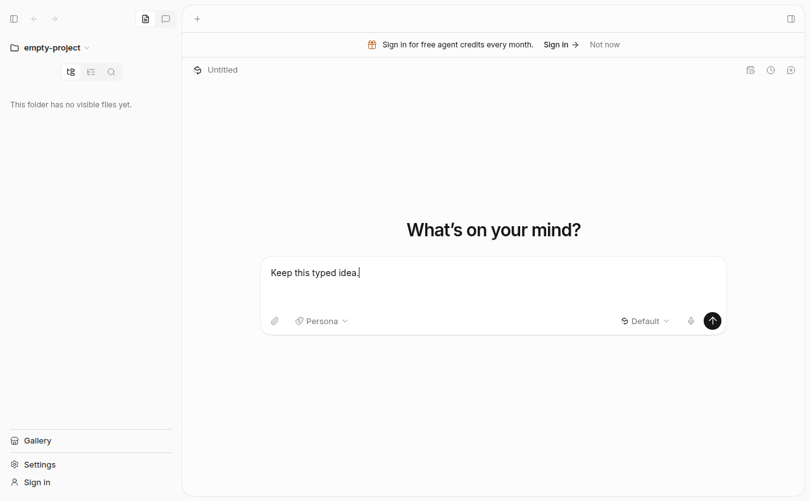
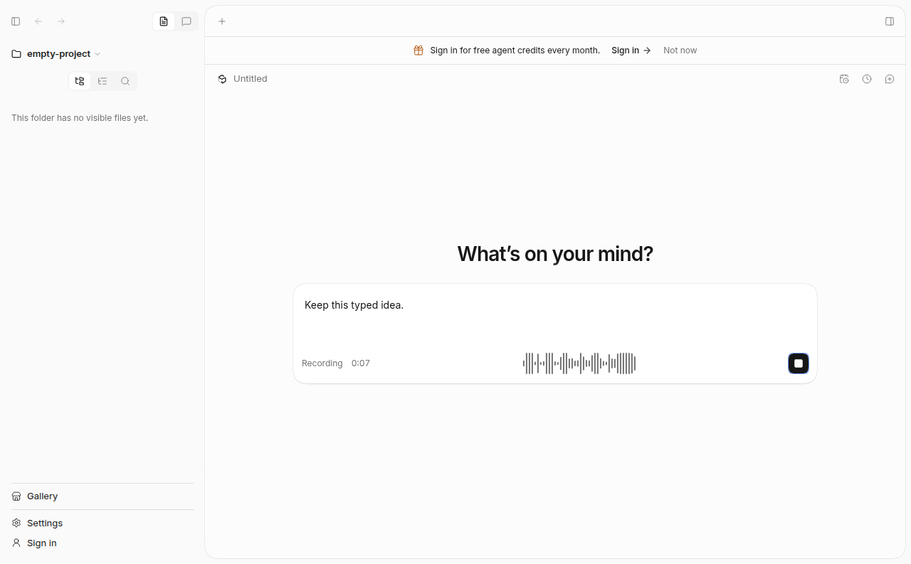
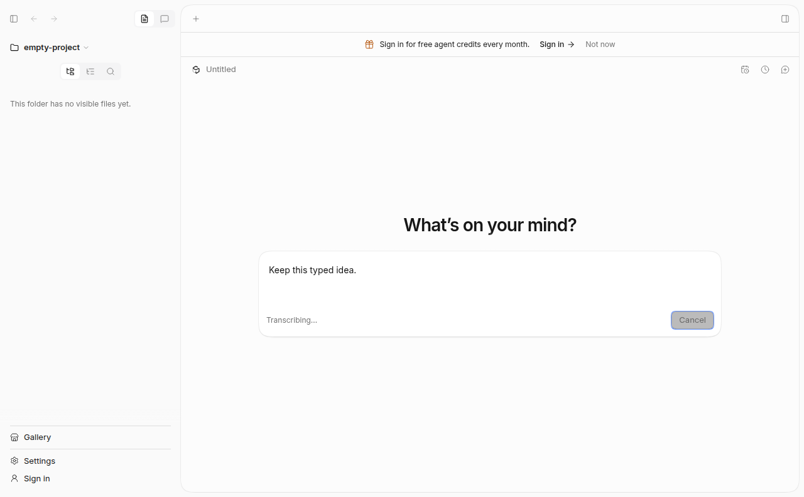
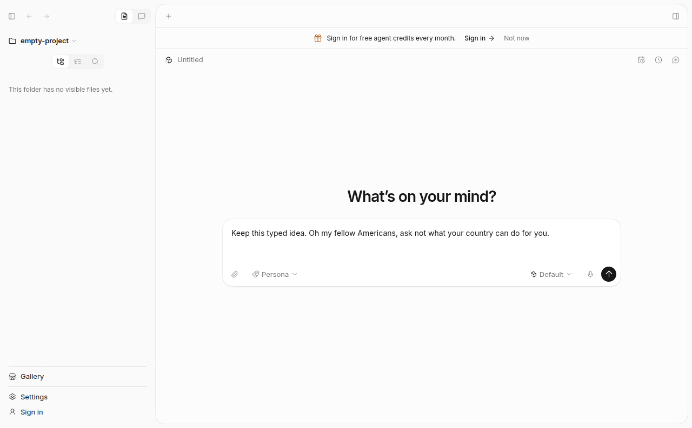
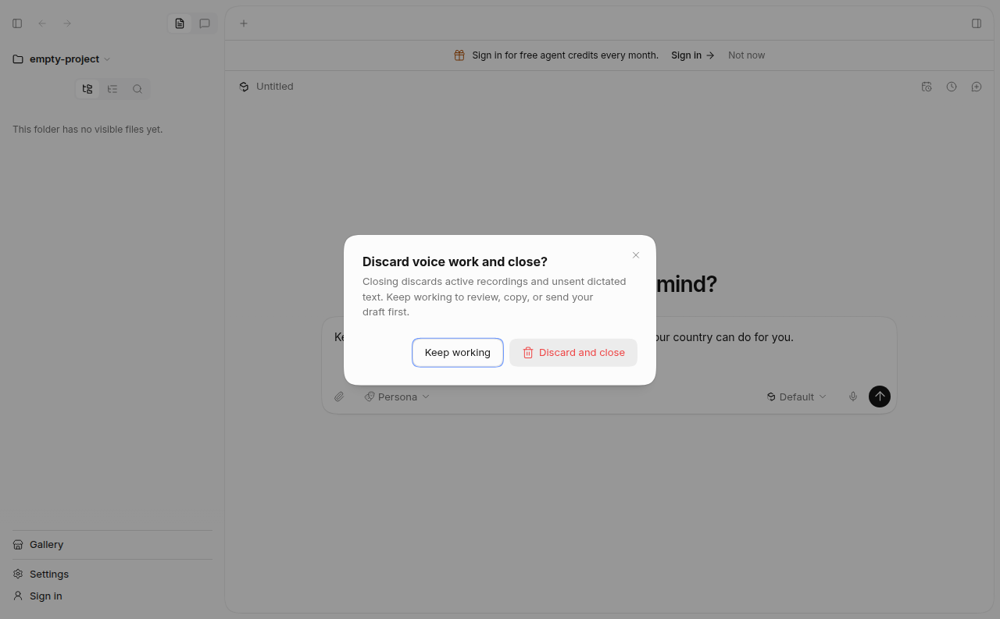
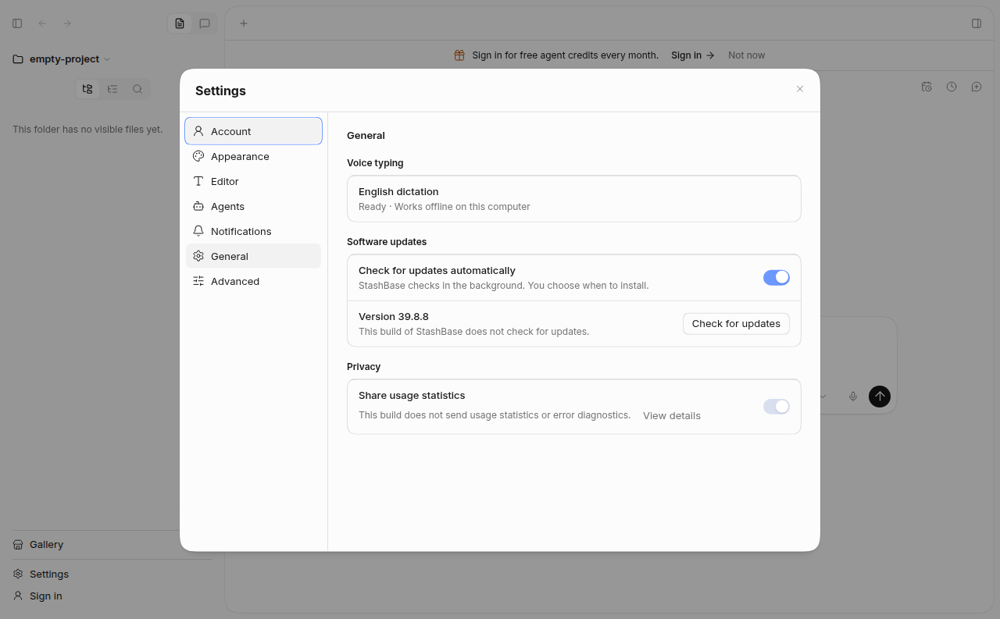

# Voice typing UI review

Source: krit22/stashbase at `1b74b23baf1d2b21f443ec14c114852c69ffeabb`.

Review images only. No application source, model weights, credentials, logs or user projects are stored on this branch.

The full-app captures use an isolated profile, public-domain fixture audio and actual local Parakeet inference. Component captures use controlled Storybook states. These do not prove physical microphone access or macOS/Windows execution. Story captures use reduced motion; see manifest.json for exact viewport dimensions.

## Built application

### Idle

### Recording

### Processing

### Completed

### Close Confirmation

### Settings

## Component states

| State | Light | Dark |
|---|---|---|
| Composer: recording | [Light](features-agent-voice-typing--recording-light.png) | [Dark](features-agent-voice-typing--recording-dark.png) |
| Composer: starting | [Light](features-agent-voice-typing--starting-light.png) | [Dark](features-agent-voice-typing--starting-dark.png) |
| Composer: processing | [Light](features-agent-voice-typing--processing-light.png) | [Dark](features-agent-voice-typing--processing-dark.png) |
| Composer: recovery | [Light](features-agent-voice-typing--recovery-light.png) | [Dark](features-agent-voice-typing--recovery-dark.png) |
| Composer: ready | [Light](features-agent-voice-typing--ready-light.png) | [Dark](features-agent-voice-typing--ready-dark.png) |
| Composer: model-not-ready | [Light](features-agent-voice-typing--model-not-ready-light.png) | [Dark](features-agent-voice-typing--model-not-ready-dark.png) |
| Settings: downloading | [Light](settings-voice-typing--downloading-light.png) | [Dark](settings-voice-typing--downloading-dark.png) |
| Settings: paused | [Light](settings-voice-typing--paused-light.png) | [Dark](settings-voice-typing--paused-dark.png) |
| Settings: verifying | [Light](settings-voice-typing--verifying-light.png) | [Dark](settings-voice-typing--verifying-dark.png) |
| Settings: ready | [Light](settings-voice-typing--ready-light.png) | [Dark](settings-voice-typing--ready-dark.png) |
| Settings: failed | [Light](settings-voice-typing--failed-light.png) | [Dark](settings-voice-typing--failed-dark.png) |
| Settings: waiting | [Light](settings-voice-typing--waiting-light.png) | [Dark](settings-voice-typing--waiting-dark.png) |
| Settings: unsupported | [Light](settings-voice-typing--unsupported-light.png) | [Dark](settings-voice-typing--unsupported-dark.png) |
